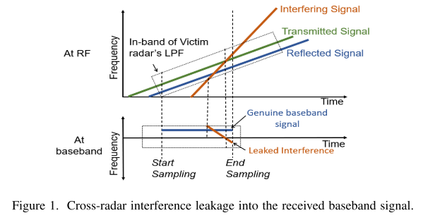
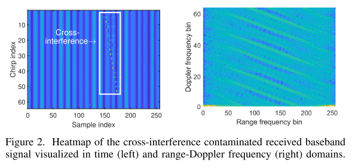
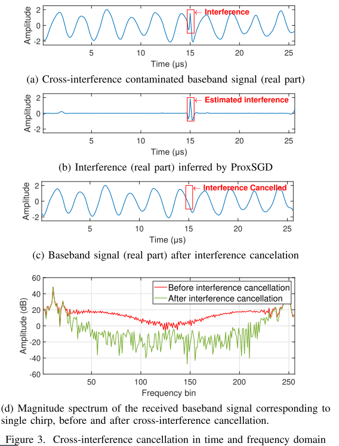
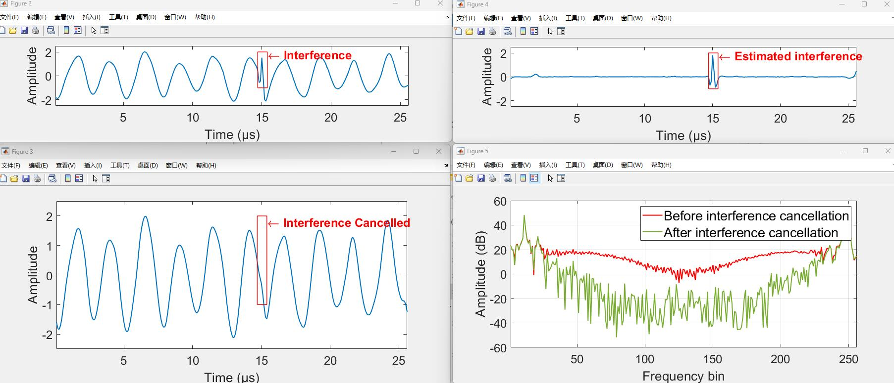

# Approximate Gradient Descent Method to Eliminate Cross-Interference in FMCW Radar [With MATLAB Code]

Introduction: Driven by the latest advancements in millimeter-wave sensing technology based on RF-CMOS and its high-resolution ranging capabilities, FMCW radar is well-suited for mainstream sensor applications to realize ADAS (Advanced Driver Assistance Systems) for next-generation semi/full autonomous vehicles. However, due to cross-interference issues, there remains controversy over large-scale and dense deployment of ADAS solutions equipped with FMCW radar. The close proximity of two or more FMCW radars operating within the same frequency band can lead to interference between them. Cross-interference from nearby radars may leak into the victim radar's received baseband signal and increase its background noise, which could result in false detection of objects and missed detection of weaker objects.
Most commercial FMCW radars mitigate cross-interference by simply nulling the corrupted samples of the received baseband signal[1], [2], [5]. However, this approach requires that the interference has been detected and located in time, and it also unintentionally introduces artifacts into the background noise in the frequency domain. Instead of nulling the corrupted samples, they can be replaced or repaired using model-based restoration techniques[3]-[4], [6]-[7]. In [3], gaps left by the disrupted samples are filled with predicted samples generated by the autoregressive model of the received baseband signal, trained online using a boolean method. However, such inpainting-based methods quickly reduce performance gaps to fill larger sizes. In [10], an adaptive filter-based cross-interference elimination method is proposed, where an adaptive filter is trained during operation to increase the signal-to-interference ratio. This is achieved by leveraging the presence of interference in the positive and negative parts of the spectrum of the received baseband signal and the absence of true baseband signal interference, as emphasized in [9]. [11], [14], [15] employ sparse modeling of cross-interference and baseband signals for model-based estimation of interference signals. In [14], SALSA (Sparse Augmented Lagrangian Shrinkage Algorithm) is used to solve the shape component analysis problem, which is proposed to separate the interference from the true baseband signal. In [15], assuming that cross-interference is sparse in time, and no interference baseband signal is modeled as a low-rank Hankel matrix. This model-based inference method for cross-interference has shown promising results, however, the resulting algorithms [12], [13], [15] are computationally intensive and not suitable for real-time implementation.
This paper proposes the idea of model-based cross interference inference and introduces a fast algorithm, ProxSGD, for joint inference and eliminating any cross interference if present in the baseband signal received by an FMCW radar. ProxSGD is an iterative process that uses new near-end subgradient updates to estimate cross interference while leveraging its sparsity in time and the sparsity in the frequency domain of the undisturbed baseband signal. ProxSGD is specifically designed to seamlessly integrate with industry standard 2D-FFT-based FMCW radar signal processing pipelines.
Article illustrations
\n        \n  
\n        \n  
Conclusion This paper proposes a new approximation of the subgradient descent method for estimating and eliminating cross-interference in frequency modulated continuous wave radar. Numerical experiments using synthetic and real world radar measurements demonstrate that the proposed method is highly effective in mitigating cross-interference in FMCW radar, and is sufficiently fast to be considered as an industry proven real-time implementation of a 2D-FFT based FMCW radar signal processing pipeline.
\n        \n  

## Images

<!-- PAYMENT_BLOCK -->

## Get this dataset

- Payment link (Stripe): [Buy now](https://buy.stripe.com/3cs8yP7sY87d0vu9AB)
- Payment QR code: 

<!-- /PAYMENT_BLOCK -->
